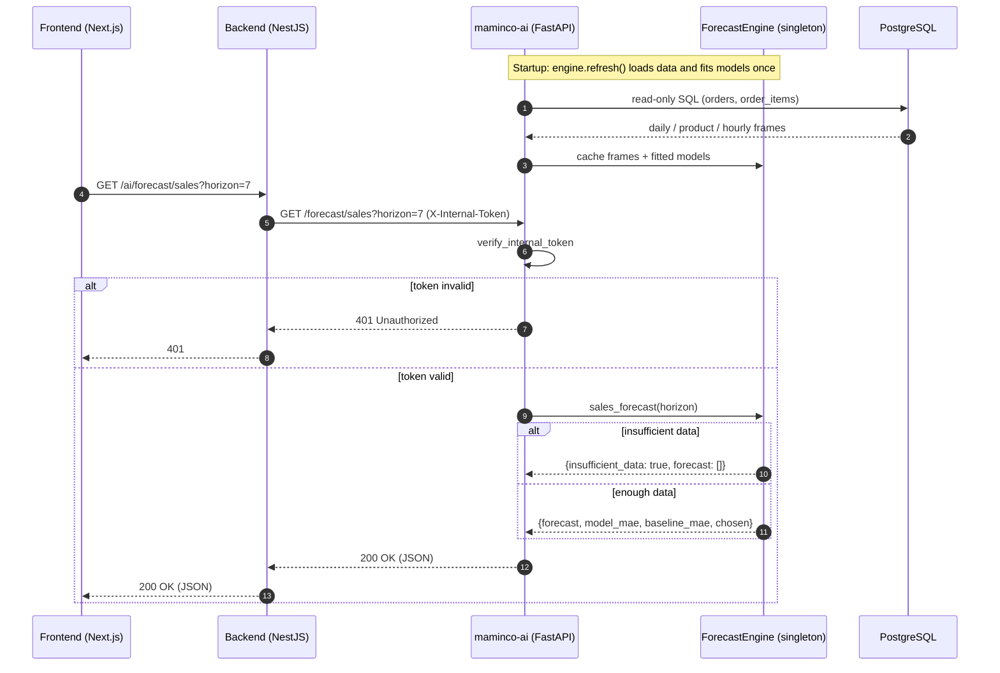

# Architecture

## Overview

`maminco-ai` is a stateless-ish FastAPI service that reads the Maminco POS
PostgreSQL database (owned by `maminco-backend`) in **read-only** mode and
serves sales forecasts and insights. The backend proxies client requests and
attaches a shared secret in the `X-Internal-Token` header.

```
┌──────────────┐   X-Internal-Token   ┌───────────────┐   read-only SQL   ┌────────────┐
│  Frontend    │ ───────────────────► │  Backend      │ ────────────────► │ PostgreSQL │
│ (Next.js)    │                      │ (NestJS:3000) │                   │            │
└──────────────┘                      └──────┬────────┘                   └─────▲──────┘
                                             │ proxy /forecast, /insights,       │
                                             │ /metrics, /train                  │
                                             ▼                                   │
                                      ┌───────────────┐   SQLAlchemy/pandas ─────┘
                                      │ maminco-ai    │
                                      │ (FastAPI:8000)│
                                      └───────────────┘
```

## Components

| Path | Responsibility |
| --- | --- |
| `app/core/config.py` | `Settings` (pydantic-settings, `AI_` prefix, `.env`). |
| `app/core/security.py` | `verify_internal_token` dependency (constant-time compare on UTF-8 bytes). |
| `app/db/session.py` | Lazy SQLAlchemy engine; read-only session guard. |
| `app/db/queries.py` | Read-only SQL -> pandas DataFrames (daily, product, hourly), bucketed in `AI_TIMEZONE`. |
| `app/models/baseline.py` | Seasonal-naive / moving-average baselines and error metrics. |
| `app/models/sales.py` | GradientBoostingRegressor + feature engineering + walk-forward backtest; fit-once. |
| `app/models/products.py` | Per-product demand models (fit-once). |
| `app/models/peak_hours.py` | Hour-of-day descriptive profile. |
| `app/models/anomalies.py` | Robust z-score + IQR anomaly detection. |
| `app/models/engine.py` | Process-wide singleton holding cached data + fitted models. |
| `app/models/train.py` | Offline entrypoint; writes JSON artifacts. |
| `app/api/*` | Routers with Pydantic response models. |

## Lifecycle

Models and data are loaded **exactly once** at startup by the FastAPI
`lifespan` handler, which calls `engine.refresh()`. Requests only read the
cached, immutable state — no per-request training, no per-request DB access.
`POST /train` re-runs the refresh/refit explicitly. Failures during refresh
are captured in `engine.state.error`; endpoints then return
`insufficient_data: true` instead of crashing.

## Forecasting method

1. Aggregate `CLOSED` orders to a continuous daily series in `AI_TIMEZONE`
   (missing days = 0).
2. Features: day-of-week, weekend flag, lag-1, lag-7, rolling means (7/14/28).
3. Walk-forward backtest: for up to 3 origins (7 days apart) refit a
   deterministic `GradientBoostingRegressor` (`random_state` = `AI_RANDOM_SEED`)
   on data before the origin and forecast the next 7 days **recursively**, the
   same way production forecasts are produced (no teacher forcing). The
   baseline is scored on the same folds.
4. Compare MAE; keep the winner. With too few training rows for any model fold
   the baseline is chosen and `model_mae` is `null`.
5. Produce a recursive multi-step forecast for the requested horizon.

`model_mae`, `baseline_mae`, `model_mape`, `baseline_mape`, `mape` (of the
chosen method), `backtest_folds` and `chosen` are always reported so callers
can see how much the ML model actually adds over the baseline.

## Graceful degradation

- Fewer than `max(AI_MIN_DAYS_REQUIRED, 36)` days *with sales* (the series is
  zero-filled, so only days with revenue count) -> `insufficient_data` for the
  sales/product forecasts; anomalies need `AI_MIN_DAYS_REQUIRED` (14).
- Database unreachable -> `insufficient_data` with a generic
  `Database unavailable.` reason; the driver error is only logged, never
  returned (it can contain host names or credentials).
- Empty product history -> product forecast returns `insufficient_data`.
- `/health` always returns `200` and reports `models_loaded`, `history_days`,
  and any `database_error`.

## Request sequence



## Data model notes

Names follow the Prisma schema in `maminco-backend/prisma/schema.prisma`:
`orders`, `order_items`, `products`, `categories`, `payments`,
`payment_methods`, `daily_metrics`, `tables`, `areas`. Order statuses are the
`OrderStatus` enum (`DRAFT`, `CLOSED`, `CANCELLED`); money columns are
`numeric` and cast to `float8` for pandas.
